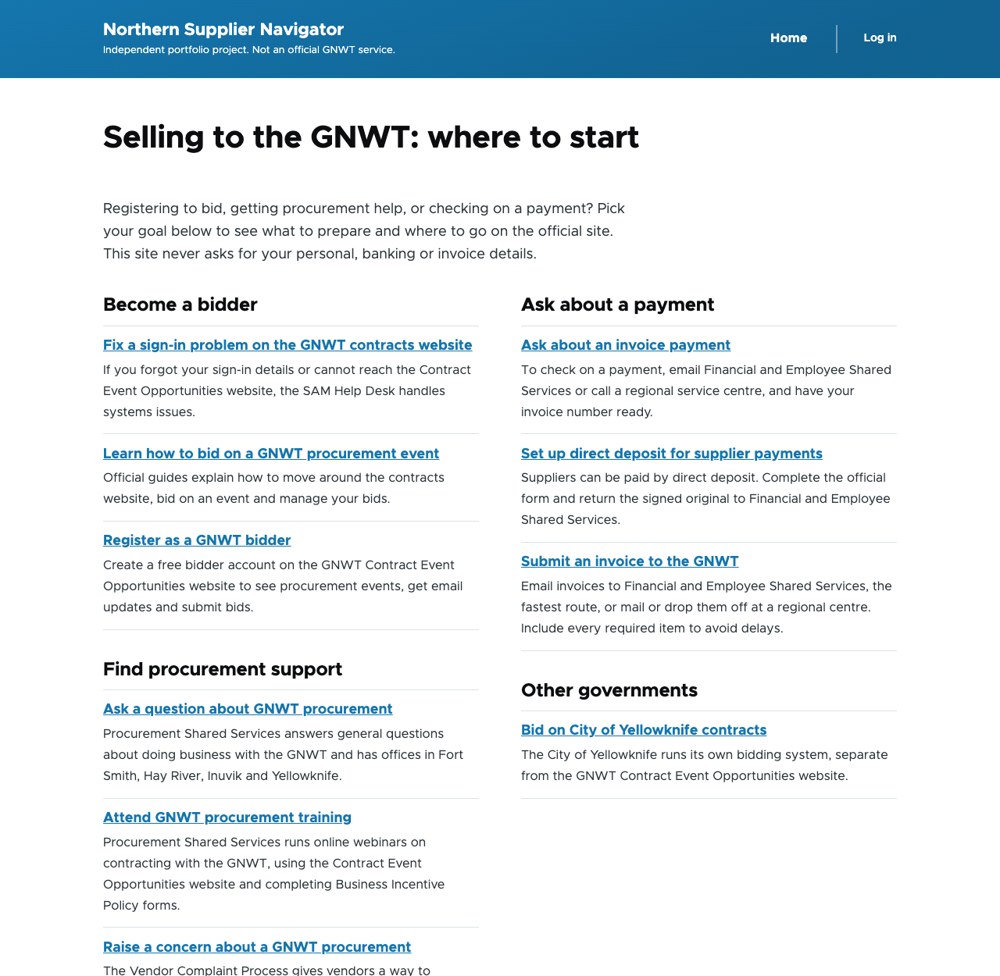
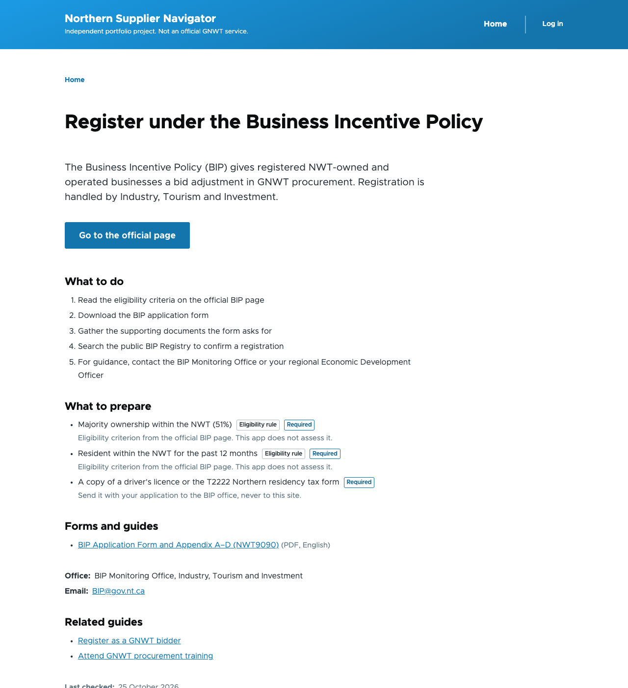
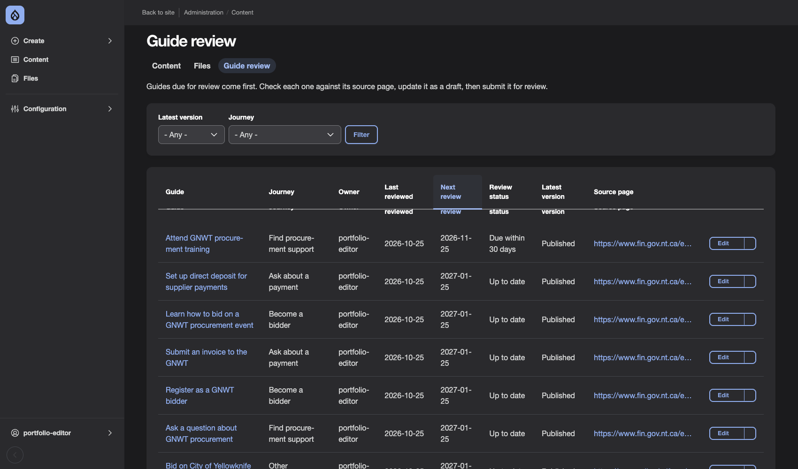

# Northern Supplier Navigator

[](https://github.com/som-sinha/northern-supplier-navigator/actions/workflows/ci.yml)

A website that helps Yellowknife-area businesses find the right GNWT service for what
they want to do, such as registering to bid, getting procurement help or asking about
a payment, and tells them what to prepare. It links to the official government pages
and never asks visitors for personal, banking, bid or invoice information.

**Live site: <https://nsn.somsinha.net>**

> **Disclaimer:** This is an independent portfolio project, not an official GNWT
> service. Its content was compiled from publicly available GNWT and City of
> Yellowknife pages, may contain errors, and is for demonstration only.

| Home page | A guide | Editor dashboard |
|---|---|---|
| [](docs/screenshots/home.png) | [](docs/screenshots/guide.png) | [](docs/screenshots/dashboard.png) |

## What this project shows

| Skill | Where to look |
|---|---|
| Drupal site building | One content type, two category lists and two paragraph types, all saved as files in [`config/sync/`](config/sync) |
| Content migration | Six import steps that load 11 guides from CSV files laid out like an old system's export: [`migrations/`](web/modules/custom/nsn_migrate/migrations), with the [field map](migrations/demo-data/README.md) and a [test that a changed row updates its page](migrations/demo-data/README.md#test-a-changed-row-updates-its-page) |
| PHP development | A custom import step, [`CsvChildren.php`](web/modules/custom/nsn_migrate/src/Plugin/migrate/process/CsvChildren.php), with [tests](web/modules/custom/nsn_migrate/tests/src/Unit/CsvChildrenTest.php) |
| Theming | A small sub-theme of Olivero with Twig templates: [`nsn_theme`](web/themes/custom/nsn_theme) |
| Editorial workflow and access | Editors draft, publishers approve, visitors cannot see drafts: [How publishing works](#how-publishing-works) |
| Upgrades and release management | A documented security update from Drupal 11.4.11 to 11.4.12: [release 1.1.0](docs/releases/1.1.0.md) and the [release process](docs/release-process.md) |
| Linux server administration | Ubuntu, Apache, PHP-FPM and MariaDB behind Cloudflare, with a firewall and key-only sign-in: [server setup](docs/server-setup.md) |
| Problem management | A real defect with its cause, fix and regression test: [defect 001](docs/defects/001-moderated-content-filter.md) |
| Source control and tooling | Git, Composer, Drush, DDEV, PHPUnit and PHP_CodeSniffer |

A CSV import is not the same as a Drupal 7-to-11 upgrade. This project shows a
content migration and a minor-version core update, not a major-version upgrade.

## Status

| Part | Status |
|---|---|
| Guide pages, categories and checklists | Done |
| Demo data: 11 guides imported from CSV, repeatable and reversible | Done |
| Editor approval steps: editors draft, publishers approve | Done |
| Home page listing guides by goal | Done |
| Dashboard showing guides due for review | Done |
| Automated tests, smoke test, documented release process | Done |
| Public server with HTTPS: <https://nsn.somsinha.net> ([how it is set up](docs/server-setup.md)) | Done |
| Nightly backup on the server, with a restore tested on a laptop ([how](docs/backup-and-restore.md)) | Done. Not yet copied off the server |
| Automated accessibility checks of four pages, with fixes ([results](docs/accessibility.md)) | Done. Fixes not on the live site yet |
| Testing by a person with a keyboard and a screen reader | Not done yet |

## How this was built

I built this project to learn Drupal, working alongside an AI coding assistant
(Claude) the way I would with a senior developer: I asked why at each step, and it
explained the Drupal concept behind the answer.

- **The decisions are mine.** I chose the scope and the audience, dropped the
  "audience" field when it turned out to repeat the journeys, kept the old system's
  CSV files untouched by adding a custom import step instead of editing them, and
  chose the home page wording.
- **I learned Drupal by doing it.** I built the content model in the admin screens,
  wrote the first import steps by hand, and debugged them from their error messages
  (wrong file paths, stale caches, a missing export of site settings).
- **The assistant reviewed my work and wrote parts of the code,** and collected the
  demo data from the public source pages (see
  [`migrations/demo-data/`](migrations/demo-data/README.md)).

## Built with

- **Drupal 11**: the content management system the site is built on
- **Apache, PHP 8.4, MariaDB 10.11**: the web server, programming language and database (the "LAMP" stack)
- **DDEV and Docker**: run all of the above on a laptop without installing it directly
- **Composer and Drush**: Drupal's tools for installing add-ons and running commands
- **PHPUnit and PHP_CodeSniffer**: automated tests and Drupal coding standard checks

## Run it on your own computer

You need Docker Desktop (or OrbStack) and [DDEV](https://ddev.com).

```bash
git clone https://github.com/som-sinha/northern-supplier-navigator.git
cd northern-supplier-navigator
ddev start
ddev composer install
ddev drush site:install --existing-config -y
ddev drush user:create portfolio-editor --mail=portfolio-editor@example.com --password="$(openssl rand -base64 24)"
ddev drush user:role:add content_editor portfolio-editor
ddev drush user:create portfolio-publisher --mail=portfolio-publisher@example.com --password="$(openssl rand -base64 24)"
ddev drush user:role:add publisher portfolio-publisher
ddev drush migrate:import --group=nsn    # loads the demo data
ddev drush uli    # prints a one-time admin login link
```

The site opens at <https://gnwt-navigator.ddev.site>. To sign in as one of the two
demo accounts, run `ddev drush uli --name=portfolio-editor` (or `portfolio-publisher`).

User accounts are stored in the database, not in Git, so the two demo accounts have
to be created on each new copy of the site. Create them before importing, because the
import looks up `portfolio-editor` by name. Every guide in the demo data
names this account as the person responsible for reviewing it.

## How publishing works

Guides go through a review before visitors see a change:

| Step | Who can do it |
|---|---|
| Save a change as a draft | Editors and publishers |
| Submit a draft for review | Editors and publishers |
| Publish, or send back to draft | Publishers only |
| Archive a guide, or restore it to draft | Publishers only |

While a change is a draft or in review, visitors keep seeing the last published
version. They cannot open drafts or the revision history. The demo data is imported
as already published.

## Keeping guides up to date

Editors and publishers have a **Guide review** tab under Content
(`/admin/content/guide-review`). It lists every guide with its source page, review
owner, last and next review dates, and the state of its latest version, with the
soonest review first. The **Review status** column says:

| Status | Meaning |
|---|---|
| Overdue | The next review date has passed |
| Due within 30 days | The next review date is in the next 30 days |
| Up to date | The next review is more than 30 days away |

The list is saved for up to an hour to keep it fast, so a guide can take up to an
hour after midnight to show as overdue.

## What's in this repository

| Folder or file | What it holds | Saved in Git |
|---|---|---|
| `.ddev/` | Settings for the local environment | Yes |
| `composer.json`, `composer.lock` | The list of add-ons and their exact versions | Yes |
| `config/sync/` | The site's settings, saved as files | Yes |
| `migrations/demo-data/` | The demo data and notes on where it came from | Yes |
| `web/modules/custom/`, `web/themes/custom/` | Code written for this project | Yes |
| `docs/`, `scripts/`, `tests/` | Release notes and process, the smoke test, and tests of the site settings | Yes |
| `web/core/`, `vendor/`, `*/contrib/` | Drupal and add-ons, downloaded by Composer | No |
| `web/sites/default/files/` | Uploaded files | No |

## Tests and checks

```bash
ddev exec vendor/bin/phpunit    # automated tests
ddev exec vendor/bin/phpcs      # Drupal coding standards
scripts/smoke-test.sh           # 14 checks of pages, access rules and site state
```

GitHub runs the first two, plus `composer validate` and `composer audit`, on PHP 8.3
(the server's version) on every push and pull request to `main`
([`ci.yml`](.github/workflows/ci.yml)). The smoke test needs a running site, so it
is not part of those checks.

Accessibility was checked with Lighthouse, axe and checks by hand: see the
[accessibility check](docs/accessibility.md) for the results and what is not tested.

The steps for updating, releasing and rolling back are in the
[release process](docs/release-process.md).

## Changing site settings

Make the change in the admin screens, then save it to files and commit:

```bash
ddev drush config:export -y
git add config/sync && git commit
```

To apply saved settings to another copy of the site, run `ddev drush config:import -y`.

## Passwords and secret keys

No passwords or secret keys are stored in Git. On a laptop, DDEV creates them in
`settings.ddev.php`, which Git ignores. On a server, set them in a `settings.local.php`
file (also ignored) or as environment variables, and create a new secret key
(`DRUPAL_HASH_SALT`) for each server:

```bash
drush php:eval 'echo \Drupal\Component\Utility\Crypt::randomBytesBase64(55) . PHP_EOL;'
```
